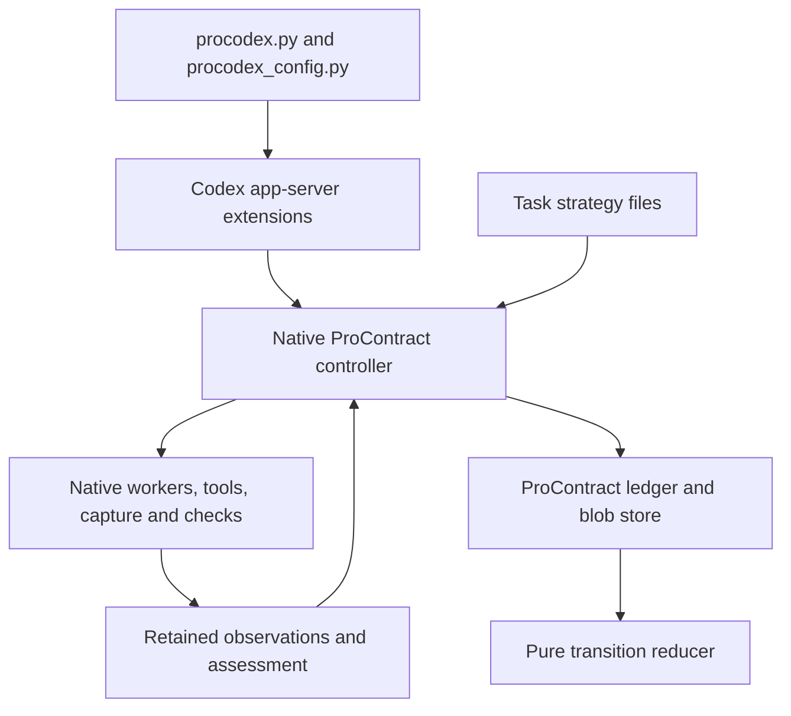
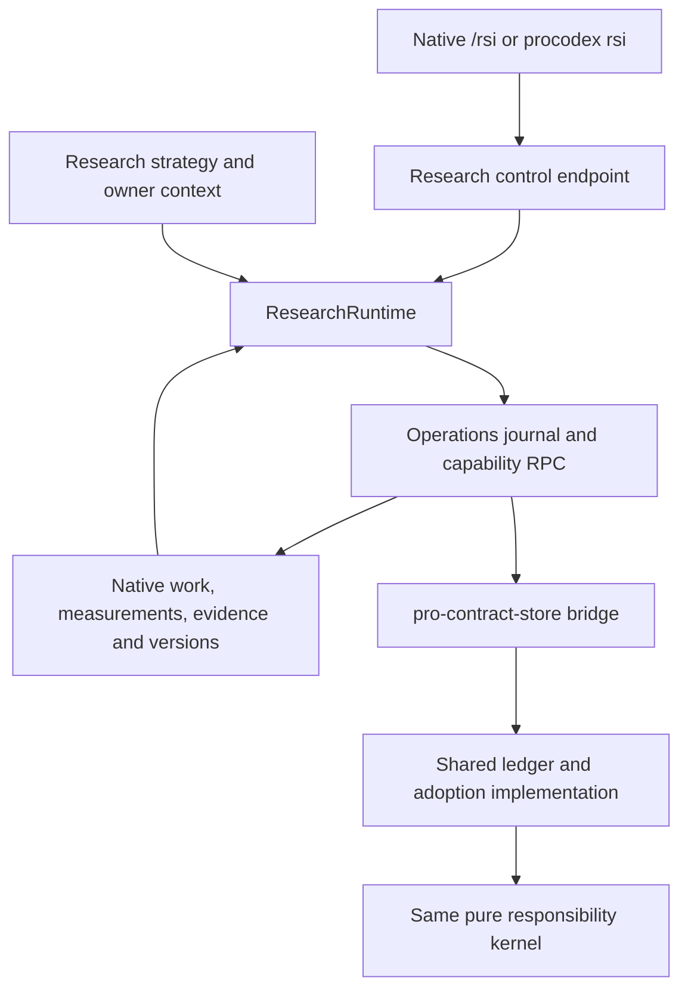

# ProContract code map

[Documentation](README.md) · [Quickstart](PROCONTRACT_QUICKSTART.md) ·
[Architecture](PROCONTRACT_LAYERS.md) · [Testing](PROCONTRACT_TESTING.md)

This map names the modules and call paths in this repository. The
[layer document](PROCONTRACT_LAYERS.md) defines the responsibilities they are
meant to have. A crate boundary is not itself an architectural guarantee.

## Read these first

The [quickstart script](../scripts/examples/procontract_quickstart.py) drives
the kernel and the credit module from one short file and is a quick way into
items 1, 2 and 6.

1. [Kernel model](../codex-rs/pro-contract/src/model.rs),
   [commands](../codex-rs/pro-contract/src/command.rs) and
   [transition](../codex-rs/pro-contract/src/transition.rs).
2. [Ledger](../codex-rs/pro-contract-store/src/store/ledger.rs): persistence around
   the reducer, including optimistic versions and idempotent commands.
3. [Native extension registration](../codex-rs/ext/pro-contract/src/lib.rs) and
   [controller runtime](../codex-rs/ext/pro-contract/src/controller/runtime.rs).
4. [Continuation strategy](../codex-rs/ext/pro-contract/policies/continuation.md)
   alongside [selection dispatch](../codex-rs/ext/pro-contract/src/controller/runtime/selection.rs).
5. [Research runtime](../scripts/procontract_research_runtime.py) and
   [operations](../scripts/procontract_operations.py) for the RSI path.
6. [Credit module](../scripts/procontract_credit.py): an improvement recorded
   as a Contract, judged on a measured effect.

## Kernel and durable storage

| Source | Main responsibility |
| --- | --- |
| [pro-contract/src/model.rs](../codex-rs/pro-contract/src/model.rs) | `Contract`, `Standing`, `Candidate`, `Coordinate`, `Support` and `Settlement`. A contract retains one current candidate, fenced by generation. |
| [command.rs](../codex-rs/pro-contract/src/command.rs) | `AuthenticatedCommand`, role/provenance, exact targets and the role required by each command. The host authenticates the actor. |
| [transition.rs](../codex-rs/pro-contract/src/transition.rs) | Pure `transition(current, command)`: role, version, coordinate and target checks; an accepted next state or a rejection. |
| [digest.rs](../codex-rs/pro-contract/src/digest.rs) / [rejection.rs](../codex-rs/pro-contract/src/rejection.rs) | Identity representation and explicit transition failures. |
| [store/ledger.rs](../codex-rs/pro-contract-store/src/store/ledger.rs) | SQLite ledger, event history, replay and transactional application of the same reducer. |
| [store/blobs.rs](../codex-rs/pro-contract-store/src/store/blobs.rs) / [capture.rs](../codex-rs/pro-contract-store/src/capture.rs) | Immutable content-addressed bytes, workspace manifests, capture and materialization. |
| [terms.rs](../codex-rs/pro-contract-store/src/terms.rs) | Request/requirement, capture, evidence and invocation data used by the host. These domain-facing records are outside the pure reducer. |
| [store/experiments.rs](../codex-rs/pro-contract-store/src/store/experiments.rs) / [store/adoption.rs](../codex-rs/pro-contract-store/src/store/adoption.rs) | Experiment/version records and atomic discharge plus incumbent selection, fenced against the observed incumbent. |
| [Store CLI](../codex-rs/pro-contract-store/src/cli.rs) / [Python bridge](../scripts/procontract_store.py) | `pro-contract-store` exposes the same hashing, capture, ledger and adoption implementation to operator and RSI tools. |

The kernel command surface includes `Issue`, `Propose`, `Support`, `Defeat`,
`Withdraw`, `Challenge`, `Discharge`, `Release` and `Revise`. The current native
automatic task lane constructs `Issue`, `Propose`, `Support` and `Defeat`; the
larger kernel API does not imply every transition is automatically exercised.

Support records an assessment of an exact subject under exact conditions. It
does not discharge the responsibility. The reducer checks the supplied coordinate;
the host supplies authentic actors, observations and evidence/reach classifications.
Neither process exit nor a controller's `resting` status is a settlement command.

## Native task harness

| Capability | Implementation entry points |
| --- | --- |
| Install and launch | [build_procodex_package.py](../scripts/build_procodex_package.py), [install_procodex.py](../scripts/install_procodex.py), [procodex.py](../scripts/procodex.py), [procodex_config.py](../scripts/procodex_config.py). The launcher provisions the local profile and starts native Codex. |
| Register with Codex | [app-server/src/extensions.rs](../codex-rs/app-server/src/extensions.rs) calls the extension's `install`; [ext/pro-contract/src/lib.rs](../codex-rs/ext/pro-contract/src/lib.rs) registers thread/turn/input, tool and prompt contributors. Activation uses `Feature::ProContract`. |
| Thread/turn lifecycle | [controller/mod.rs](../codex-rs/ext/pro-contract/src/controller/mod.rs), [runtime.rs](../codex-rs/ext/pro-contract/src/controller/runtime.rs), [runtime/recovery.rs](../codex-rs/ext/pro-contract/src/controller/runtime/recovery.rs). These own runtime state and recovery around persistent contracts. |
| Effect boundary | [ports.rs](../codex-rs/ext/pro-contract/src/controller/ports.rs) defines worker, observation, checking, interruption and successor operations; [native.rs](../codex-rs/ext/pro-contract/src/controller/native.rs) implements them using Codex. |
| Worker context | [workers/packet.rs](../codex-rs/ext/pro-contract/src/workers/packet.rs), [request_sources.rs](../codex-rs/ext/pro-contract/src/workers/request_sources.rs), [policies.rs](../codex-rs/ext/pro-contract/src/workers/policies.rs), [controller/views.rs](../codex-rs/ext/pro-contract/src/controller/views.rs). They bind and bound delivered context; policy files supply methods. |
| Draft, probe and review | [workers/drafter.rs](../codex-rs/ext/pro-contract/src/workers/drafter.rs), [prober.rs](../codex-rs/ext/pro-contract/src/workers/prober.rs), [reviewer.rs](../codex-rs/ext/pro-contract/src/workers/reviewer.rs), [runtime.rs](../codex-rs/ext/pro-contract/src/workers/runtime.rs). Schemas and execution are code; instructions are replaceable context. |
| Capture and observations | [capture_barrier.rs](../codex-rs/ext/pro-contract/src/controller/capture_barrier.rs), [observations.rs](../codex-rs/ext/pro-contract/src/controller/observations.rs), [checks.rs](../codex-rs/ext/pro-contract/src/checks.rs), [execution.rs](../codex-rs/ext/pro-contract/src/execution.rs). These retain concrete subjects, outcomes and execution receipts. |
| Evidence access | [archive.rs](../codex-rs/ext/pro-contract/src/controller/archive.rs), [evidence_tool.rs](../codex-rs/ext/pro-contract/src/controller/evidence_tool.rs), [workers/review_evidence.rs](../codex-rs/ext/pro-contract/src/workers/review_evidence.rs). Tools expose scoped retained evidence to actors. |
| Progress and assessment | [runtime/progress.rs](../codex-rs/ext/pro-contract/src/controller/runtime/progress.rs), [runtime/verification.rs](../codex-rs/ext/pro-contract/src/controller/runtime/verification.rs), [decision.rs](../codex-rs/ext/pro-contract/src/controller/decision.rs), [work.rs](../codex-rs/ext/pro-contract/src/controller/work.rs). Observations, partial assessments and kernel judgments have distinct representations. |
| Continuation and succession | [runtime/continuation.rs](../codex-rs/ext/pro-contract/src/controller/runtime/continuation.rs), [selection.rs](../codex-rs/ext/pro-contract/src/controller/runtime/selection.rs), [succession.rs](../codex-rs/ext/pro-contract/src/controller/runtime/succession.rs), [successor.rs](../codex-rs/ext/pro-contract/src/controller/successor.rs), [succession_budget.rs](../codex-rs/ext/pro-contract/src/controller/succession_budget.rs). Strategy selects offered work; mechanisms execute and retain it under original authority. |
| Delivery, inputs and limits | [runtime/delivery.rs](../codex-rs/ext/pro-contract/src/controller/runtime/delivery.rs), [procodex_inputs.py](../scripts/procodex_inputs.py), [settings.rs](../codex-rs/ext/pro-contract/src/settings.rs), [resources.rs](../codex-rs/ext/pro-contract/src/resources.rs). Optional task deadlines and supplied count limits are separate from local operation bounds. |

### Inherited Codex capabilities

Conversation history and compaction also involve
[core/context_manager](../codex-rs/core/src/context_manager/) and
[core/compact.rs](../codex-rs/core/src/compact.rs). Tool dispatch and shell execution
remain in [core/tools](../codex-rs/core/src/tools/) and
[unified_exec](../codex-rs/core/src/tools/handlers/unified_exec/).
Tool composition is provided by [code-mode](../codex-rs/code-mode/),
[code-mode-host](../codex-rs/code-mode-host/) and
[code-mode-runtime](../codex-rs/code-mode-runtime/).

These are existing harness mechanisms. ProContract-specific context assembly,
evidence access and continuation live at the extension boundaries above.

## RSI and version delivery

| Source | Main responsibility |
| --- | --- |
| [tui/research_control.rs](../codex-rs/tui/src/research_control.rs), [slash_command.rs](../codex-rs/tui/src/slash_command.rs) | Native `/rsi` request parsing and transport to the provisioned Unix-socket endpoint. The frontend does not choose a research workflow. |
| [procontract_research_control.py](../scripts/procontract_research_control.py) | Owner control for `start`, `resume`, `status`, `cancel` and `input`; request identity and endpoint lifecycle. |
| [procontract_research_runtime.py](../scripts/procontract_research_runtime.py) | `ResearchRuntime`: provisioning, owner-context generations, selected work/returns, supervision and concrete capability dispatch. |
| [procontract_operations.py](../scripts/procontract_operations.py) | `Operations`: durable execution/evidence journal, immutable versions, observations, capability authority, cancellation and authorized adoption through the store. |
| [procontract_operations_rpc.py](../scripts/procontract_operations_rpc.py) | Actor-facing operation descriptions and scoped RPC. |
| [procontract_evidence.py](../scripts/procontract_evidence.py), [procontract_evidence_bundle.py](../scripts/procontract_evidence_bundle.py) | Retained source bytes, bounded reads, evidence/knowledge imports and exports. Importing observations does not itself select a policy. |
| [strategies/research](../strategies/research/) | Replaceable continuous-research and trajectory-analysis instructions. |
| [procontract_delivery.py](../scripts/procontract_delivery.py), [procontract_native_trace_binding.py](../scripts/procontract_native_trace_binding.py) | Delivery selection/materialization and binding retained traces to actual native requests. |

The research journal at `host/operations.sqlite` tracks operations and choices.
It is distinct from the contract ledger `ledger_1.sqlite`. RSI reuses the existing
kernel/store for responsibility and adoption; its scheduler and evidence journal
do not constitute a second settlement kernel. See the
[operations contract](PROCONTRACT_OPERATIONS.md) and
[runtime interface](PROCONTRACT_RESEARCH_RUNTIME.md) for exact capability schemas.

## Credit and decision-level measurement

These modules are libraries and measurement runners with their own tests. The
credit module is not wired into `Operations` or the research runtime, which
keep their own adoption path.

| Source | Main responsibility |
| --- | --- |
| [procontract_credit.py](../scripts/procontract_credit.py) | `ledger` (what each segment of one record acquired, kept and lost), `effect` (two continuations of one state that differ in one input) and `reach`; an improvement as one Contract through `locate`, `propose`, `judge`, `adopt`, `withdraw` and `restore`. Tests: [test_procontract_credit.py](../scripts/test_procontract_credit.py), [test_procontract_credit_receipts.py](../scripts/test_procontract_credit_receipts.py). |
| [procontract_fork.py](../scripts/procontract_fork.py) | What checkpoint, continuation and measurement receipts must state before two executions count as a fork of one state. It runs nothing. Tests: [test_procontract_fork.py](../scripts/test_procontract_fork.py). |
| [procontract_migration.py](../scripts/procontract_migration.py) | Explicit migration of a store written before acceptances were recorded: a read-only plan from a snapshot, applied to a new target store. |
| [procontract_replay_transport.py](../scripts/procontract_replay_transport.py), [procontract_decision_replay.py](../scripts/procontract_decision_replay.py) | Send one retained model request as the bytes it was kept as, once; the Operations measurement runner around that step. |
| [procontract_decision_study.py](../scripts/procontract_decision_study.py), [procontract_decision_study_spec.py](../scripts/procontract_decision_study_spec.py), [procontract_decision_study_admission.py](../scripts/procontract_decision_study_admission.py) | A decision study as a `ResearchRuntime` measurement: the adapter, the pure study specification and readout, and the shared admission slot. |
| [procontract_frozen_evidence.py](../scripts/procontract_frozen_evidence.py) | Capture and reopen, read-only, one invocation's public evidence view. |
| [controller/selector_capture.rs](../codex-rs/ext/pro-contract/src/controller/selector_capture.rs), [procontract_selector_capture.py](../scripts/procontract_selector_capture.py) | The opt-in native hook that records a selector exchange, and the gateway side that binds it to the request actually sent. |
| [controller/archive_export.rs](../codex-rs/ext/pro-contract/src/controller/archive_export.rs), [procontract_selector_tools.py](../scripts/procontract_selector_tools.py), [procontract_selector_exchange.py](../scripts/procontract_selector_exchange.py), [procontract_selector_receipts.py](../scripts/procontract_selector_receipts.py) | Native export of the public archive, an isolated code-mode session that can only read a frozen evidence view, the Operations runner for one selector exchange, and the receipts derived from its records. |
| [procontract_policy_splice.py](../scripts/procontract_policy_splice.py) | Replace only the strategy text inside a retained selector request. |

## Strategy loading and legacy research

The native [`Policies::load`](../codex-rs/ext/pro-contract/src/workers/policies.rs)
loader resolves five files: `work_method.md`, `drafter.md`, `prober.md`,
`reviewer.md` and `continuation.md`. Missing files retain built-in defaults.
Worker output schemas and allowed operations remain implemented in code.
RSI research context is separately supplied by its protected runtime profile;
research-version and task-version delivery are separate facts.

`procodex rsi` dispatches to the current research control interface.
`procodex rsi-legacy` retains [procontract_rsi.py](../scripts/procontract_rsi.py)
and the older campaign machinery. Files such as
[procontract_study.py](../scripts/procontract_study.py),
[procontract_release.py](../scripts/procontract_release.py) and the older
`procontract_ph_*` modules describe those study workflows. In particular,
`procontract_release.py` is historical policy-adoption code, **not the binary
package builder**.

## Where to make a change

| Intended change | Start here |
| --- | --- |
| A domain-independent authority or stale-evidence rule | Kernel model/transition and their reference-model tests. |
| Worker context, retrieval or receipt presentation | Worker packets, views, archive/evidence tools; inherited context manager when the change concerns conversation history. |
| Tool execution, waiting, cancellation or process recovery | Native ports/execution/successor code; operations/runtime code for RSI dispatch. |
| Diagnosis, probing, verification or handoff choices | Task/research strategy context and the capability description it consumes. |
| Durable source, version or adoption bindings | Store and operations APIs, with positive and conflicting-retry controls. |
| ProgramBench preparation, grading or reporting | Benchmark adapters such as [procontract_canonical.py](../scripts/procontract_canonical.py), [procontract_evaluator_runtime.py](../scripts/procontract_evaluator_runtime.py) and [procontract_evaluator_artifacts.py](../scripts/procontract_evaluator_artifacts.py). |
| Package, installation or release identity | Build/installer scripts and [release documentation](PROCONTRACT_RELEASE.md). |

Current migration work is visible in the native controller: drafting/probing,
verification orchestration and some repair policy still reside in code alongside
strategy-selected continuation. The kernel has a single current candidate per
contract; it is not a general multi-candidate acceptance DAG. Keep these facts
distinct from the architectural goal when extending the system.

## Tests and evidence

Recent harness paths are particularly relevant to trajectory-driven RSI:

| Capability | Source and boundary |
| --- | --- |
| Continue admitted work during an acceptance dispute | [runtime/continuation.rs](../codex-rs/ext/pro-contract/src/controller/runtime/continuation.rs) and [workers/continuation.rs](../codex-rs/ext/pro-contract/src/workers/continuation.rs) offer the host-bound original request admission independently of disputed derived terms. Acceptance and existing resource/owner checks remain separate. |
| Reuse a completed computation across assessments | [archive.rs](../codex-rs/ext/pro-contract/src/controller/archive.rs) freezes the host-published source allowlist; [review_evidence.rs](../codex-rs/ext/pro-contract/src/workers/review_evidence.rs) exposes `receipt:<sha256>` through bounded reads and fresh citations. [inspection_grant.rs](../codex-rs/ext/pro-contract/src/inspection_grant.rs) validates original conditions without renewing an execution grant. |
| Inspect frozen artifacts | [inspection.rs](../codex-rs/ext/pro-contract/src/inspection.rs) executes admitted computations over selected frozen bytes and declared inputs. Selected files retain names and captured relative directories under `/sources/current/` and `/sources/baseline/`; legacy `/evidence/file-N` and `/evidence/baseline-N` aliases remain. `/sources/manifest.json` records complete selected paths. These read-only views contain only selected regular files, not the original workspace or environment. Schema 3 receipts bind both views, captured paths and source subjects; reuse still recognizes legacy schema 1/2 under their original semantics. The profile supplies the image and resource ceilings. |
| Retain context and action feedback for research | [procontract_research_runtime.py](../scripts/procontract_research_runtime.py) and [procontract_operations.py](../scripts/procontract_operations.py) provide the existing research/operation interfaces; protected source bindings, bounded context queries, step receipts and explicit correction views support later investigation. |
| Retain native execution history | [harness/observations/](../harness/observations/) retains selected native command-execution events as exact bytes with an index, and composes them into a capture provider's observations. Its tests are in the same directory. |

The native reader exposes original captured bytes through the `baseline` catalog
and `baseline:N` reads, including the original and assessed subject identities.
Original pages are comparison context; their citations do not directly support
the current artifact. Ordinary task-history retrieval remains migration work.
Prototype task-step scripts are not activated in this release.

[Kernel reference-model tests](../codex-rs/pro-contract/src/reference_model_tests.rs),
[transition tests](../codex-rs/pro-contract/src/transition_tests.rs),
[adoption tests](../codex-rs/pro-contract-store/src/store/adoption_tests.rs),
[operations tests](../scripts/test_procontract_operations.py),
[research-runtime tests](../scripts/test_procontract_research_runtime.py) and
[native continuous-work tests](../scripts/test_procontract_continuous_native.py)
cover different boundaries. The [testing guide](PROCONTRACT_TESTING.md) gives the
commands and distinguishes local native integration from real-model measurements.

## Documents

Every `docs/PROCONTRACT_*.md` file, by the part of the code it describes.

| Document | What it covers |
| --- | --- |
| [QUICKSTART](PROCONTRACT_QUICKSTART.md) | Build the store binary and run one script: a task under the kernel and one self-improvement step. |
| [RELEASE](PROCONTRACT_RELEASE.md) | Build the `procodex` package from source, install it and run it. |
| [TESTING](PROCONTRACT_TESTING.md) | The test commands in the repository and what each one needs. |
| [CODE_MAP](PROCONTRACT_CODE_MAP.md) | This map. |
| [LAYERS](PROCONTRACT_LAYERS.md) | What belongs to the kernel and what to the evolvable harness, and the development rule that follows. |
| [OPERATIONS](PROCONTRACT_OPERATIONS.md) | The `Operations` interface: durable execution and evidence operations, capability authority, and version selection and adoption through the store. |
| [RESEARCH_RUNTIME](PROCONTRACT_RESEARCH_RUNTIME.md) | `ResearchRuntime`: provisioning, owner control, actor capabilities, and candidate projects and measurements. |
| [PUBLICATION_RECOVERY](PROCONTRACT_PUBLICATION_RECOVERY.md) | Progress publication as an operation that outlives the caller that requested it. |
| [OBSERVATION_DELIVERY](PROCONTRACT_OBSERVATION_DELIVERY.md) | How execution observations are retained as typed sources and delivered to later work and review. |
| [CONTEXT_COST](PROCONTRACT_CONTEXT_COST.md) | The working context as a replaceable view of a task: the native context-window profile, and actor identity and cost. |
| [CONTEXT_OBSERVATION](PROCONTRACT_CONTEXT_OBSERVATION.md) | `source_context`: reading the context that a retained native request actually delivered. |
| [CREDIT](PROCONTRACT_CREDIT.md) | The credit module: ledger, effect and reach, an improvement as one Contract, judgments by receipts, samples and series, and store migration. |
| [STEP_CREDIT](PROCONTRACT_STEP_CREDIT.md) | Step-level credit: attributing an outcome to single decisions and choosing the comparison that tests them. |
| [DECISION_REPLAY](PROCONTRACT_DECISION_REPLAY.md) | Sending one retained model request again, once, as an Operations measurement. |
| [DECISION_STUDY](PROCONTRACT_DECISION_STUDY.md) | Decision studies as an opt-in research measurement: registration, execution and recovery, and reading the observation. |
| [FROZEN_EVIDENCE](PROCONTRACT_FROZEN_EVIDENCE.md) | Capturing and reopening, read-only, the public evidence view of a selector state. |
| [SELECTOR_CAPTURE](PROCONTRACT_SELECTOR_CAPTURE.md) | The opt-in hook that records an actual initial selector exchange with its evidence view and final request bytes. |
| [SELECTOR_EXCHANGE](PROCONTRACT_SELECTOR_EXCHANGE.md) | The parts of a selector exchange run from a capture, and what each has been tested with. |
| [POLICY_SPLICE](PROCONTRACT_POLICY_SPLICE.md) | Replacing only the strategy text inside a retained selector request, with a proof of what changed. |
| [RECORD_EVOLUTION](PROCONTRACT_RECORD_EVOLUTION.md) | Proposed record-level semantics for proposals, judgments and acceptances. A design, not the deployed kernel. |
| [HARNESS_EVOLUTION](PROCONTRACT_HARNESS_EVOLUTION.md) | Harness interfaces to evolve, derived from retained trajectories, and the choices that stay with strategy. |
| [HARNESS_EVOLUTION_ORDER](PROCONTRACT_HARNESS_EVOLUTION_ORDER.md) | The order chosen for those harness changes and the reason for each. |
| [UPSTREAM_INTEGRATION](PROCONTRACT_UPSTREAM_INTEGRATION.md) | How an upstream Codex merge was integrated and which upstream interfaces the harness should use. |
| [UPSTREAM_CHANGES](PROCONTRACT_UPSTREAM_CHANGES.md) | The upstream Codex files that this fork modifies. |
