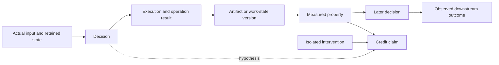

# Step credit for end-to-end RSI

Step-level attribution can make RSI choose smaller, better targeted changes.
The unit is an observable decision and its consequences: an instruction delivered,
a reference selected, an artifact edited, an operation launched, a context
replaced, or a stopping decision. One decision may span several tool calls; one
batch may contain several independent decisions. A chat turn is not the default
unit of credit.

This remains **one kernel plus an evolvable harness**. Credit is empirical,
revisable knowledge, not responsibility, acceptance authority or a new kernel
transition. A failed task can contain useful steps; a successful task can contain
harmful or unnecessary work.

## Attribution questions

Keep three relations distinct:

1. Execution/exposure: what happened, which exact input reached which actor,
   what artifact/state changed, and what resources were charged.
2. Contribution: a source-bound explanation connecting a decision to a measured
   property, with competing explanations and contrary evidence.
3. Intervention effect: a measured comparison after replacing a defined action
   or capability while holding its preconditions appropriately fixed.

These describe evidence, not universal confidence levels or a mandatory workflow.
Observational explanations can guide research before a counterfactual is available.
An alleged cause arriving after the change can be refuted without another rollout.

For replayable pre-decision state `x`, actions `a` and `a'`, continuation policy
`pi` and observation scope `h`, the causal question is:

```text
credit_m(x, a, a'; pi, h)
  = E[Y_m after do(a), starting from x, continuing with pi, observed over h]
  - E[Y_m after do(a'), starting from x, continuing with pi, observed over h].
```

`m` can be behavior, final quality, lifecycle, latency or cost. The baseline is
explicit: omit a review, use another reference, retain an artifact, or use another
context mechanism. There is no unique intrinsic scalar credit. An unavailable
alternative is a capability intervention, not an action the original agent could
have chosen. Keep outcome dimensions separate until task preferences define their
tradeoff; include failed/cancelled work and unknown charges.

No global deadline or time discount is required. An open-ended task can be studied
at a named milestone, artifact version or observation cut. Its unavailable later
outcome stays unknown rather than becoming zero.

## A dependency graph over existing identities



`delivered_to` and `produced` are execution relations, not proof of `caused`.
Source availability, actual delivery, comprehension, proposed action and completed
effect are different facts. Link thread/turn/request/cell/operation IDs, resolved
inputs, artifact/evidence identities and versioned measurements. Evidence handles
avoid copying the full transcript into every claim. Attribute observable choices;
hidden model deliberation need not be exposed or certified. Keep safe lifecycle
telemetry separate from authorized capture of task material.

A reviewer may identify a defect, a selector choose repair, an executor implement
it and a tool validate it. Giving the full gain to every role double counts one
result. Preserve the chain or joint decision set; estimate a marginal effect or
interaction when that comparison is useful. Exhaustive Shapley allocation is not
a prerequisite. Missing links can remain unknown without erasing other evidence.

## Concrete current evidence

| Step | Supported attribution | Further question |
|---|---|---|
| Cargo root line 71; brief first delivered request 9 later | Initial reserve assumption predates that contract exposure | Did later brief/review reinforce it? |
| Batched event 480 → request 364 → successor line 149 | Reference choice was delivered and full-history generation implemented | Would a different strategy make the model choose differently? |
| ATRX capture provider | Dependency traversal consumed the bound and omitted the output | Would delivering that output alter review or final quality? |
| Math publication 10, request 466 | Live reviewer outlasted caller; pending operation blocked continuation | Would reattachment improve final quality; why did host exit? |
| Dedup and Embedding successes | Reviews accompanied concrete repairs and actual passing checks | Which reviews were necessary, and what cheaper alternatives existed? |

The local Batched intervention (retained with the experiment records, which are
not part of this repository) changes only the coherent generation-state choice in the final retained artifact.
On 42 fresh public-model probes, 14 outputs change. All 20 short-context controls
stay unchanged; warm/reversed batches and the unaffected scoring API remain
consistent. Rolling-reference agreement changes 28/42 → 42/42; full-history
agreement changes 42/42 → 28/42. This establishes a local executable effect.
Its quality sign depends on the intended convention. Public reference ambiguity
remains; this is not a prompt-level effect, a new benchmark score or generalization.

## Use the comparison that answers the question

- **Artifact/operation replay:** replace one semantic choice, capture selection,
  retrieval result or lifecycle behavior; measure affected and unchanged properties.
  Often this needs no model call.
- **Checkpoint continuation:** fork the recoverable pre-decision state, change
  delivered context/action/capability, and let the continuation policy react.
  Replaying the old tool-call suffix ignores the changed state. Bind versions,
  inputs, active effects, tool state and resource conditions; repeated paired
  observations may be useful for stochastic suffixes. One pair remains one pair.
- **Transfer evaluation:** implement the general harness/strategy change and
  evaluate fresh selected tasks before adopting it at that scope.

A checkpoint includes more than chat: files, sessions/processes, outstanding
effects, actual context, external snapshots and reservations can matter. Operation
ownership and source recovery therefore precede broad credit-guided RSI. An
incomplete checkpoint can still support a narrower local comparison with explicit
uncontrolled variables.

For live services and irreversible actions, use recorded snapshots, sandbox or
dry-run capabilities, or naturally available comparisons. Analysis does not repeat
real purchases, publications or messages. Hidden benchmark feedback can diagnose
completed work and suggest general mechanisms; it must not be inserted into the
original decision prefix or a live solver's inputs.

Select branch points from the affected property and its dependency chain. Include
passing, failing, expensive and cheap contrasts rather than only the last bad edit
or best-looking fork. Retained versions distinguish acquired, preserved and lost
behavior. Step effects need not add up to terminal reward: actions interact,
repair one another and act through overlapping paths.

## Fit to existing RSI operations

Use existing objects rather than another credit kernel or a contract per call:

| Existing object | Relevant content |
|---|---|
| source | Original trace slice, actual request, artifact/checkpoint, result |
| observation | Action, delivery, state/version change, cost or probe outcome |
| knowledge | Attributed decision/group, property, baseline, mechanism, scope, uncertainty, counterevidence and corrections |
| version / resolved | Candidate harness/strategy and actual later delivered inputs |
| assignment / outcome | Selected intervention and measured authorized execution |
| adoption | Existing scoped decision; narrative credit cannot supply authority |

A structured `knowledge.subject` can carry the decision coordinates without a
host schema change:

```json
{
  "kind": "step_attribution",
  "episode": "retained task identity",
  "decisions": ["source-bound event or operation reference"],
  "affected_property": "named behavior or outcome",
  "comparison": "explicit alternative and observation scope",
  "attribution_target": "executable decision, delivered strategy, or capability",
  "evidence_kind": "observed relation, explanation, or intervention",
  "intervention_outcome": "existing outcome/observation identity when present"
}
```

The research agent chooses what to inspect and which offered experiment to run.
An outcome wakes the same responsibility; the agent revises its claim, authors an
authorized version, and selects further measurement or adoption as warranted.
This is an available E2E path, not a fixed analyst/critic/adopter workflow. Record
actual source consumption, candidate delivery and measurements; storing knowledge
alone is intake. The optional [research strategy](../strategies/research/attribute_decisions.md)
is context-level guidance, not a reward model or frozen-cohort prompt change.

## Improve attribution itself

Evaluate localization and effect direction with planted defects, known good
decisions, misleading final rewards, later-arriving alleged causes, missing
context, concurrency and interacting repairs. Check preservation of good behavior
and false causal claims. Then compare fresh-task quality and total research-plus-
task cost with the previous method. More persuasive explanations are not the
learning objective.

Support counts, reviews, test counts and conservative rejection are not rewards
by default. A useful test can lower an apparent score by revealing a defect; a
passing check can exercise the wrong behavior. Kernel preserves responsibility
and evidence relations, harness measures effects, and strategy interprets them.
This supports test-time system-policy improvement and training-data selection;
model-weight RL requires an actual separate weight update. A process-reward model
may propose branch points, with its judgments tested against outcomes.

## Observable trajectory return

`scripts/procontract_trajectory_projection.py` writes a readable projection before
raw native files are archived. Each retained record binds its original source hash,
line, decompressed byte offset, line hash and actor identity. Observable responses,
tool lifecycle and context transitions stay available; opaque reasoning is omitted.
Malformed records and missing sources remain explicit. The projection assigns no
causal edge, role inferred from an alias, confidence or numeric credit.

A ProgramBench study calls this same observer in both arms after
solver shutdown. Its measurement adapter captures the projection, score, costs and
submission through the existing source store and returns their handles to the
research responsibility. The returning agent can inspect new successful and failed
steps before choosing a scoped version decision. This is separate from the older
retrospective-only evidence intake and does not alter a frozen solver's context.
